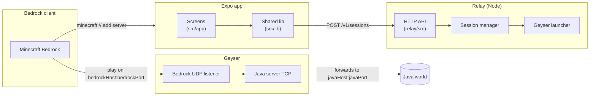

# NetherNet

Connect **Minecraft Bedrock** clients to **Java Edition** servers without running Geyser on your phone. NetherNet pairs a mobile **Expo** app with a **relay** service that spins up per-session [Geyser](https://geysermc.org/) bridges and returns the Bedrock address your client should join.

## Architecture



### End-to-end flow

1. **Resolve target** — The app parses a Java address (host, port, SRV) via `src/lib` helpers (`address`, `status`, `motd`).
2. **Open relay session** — `RelayClient` calls the relay `POST /v1/sessions` with the Java host/port and auth mode. The relay allocates a UDP port from its pool (default **19132–19232**), writes a Geyser config, and starts Geyser (standalone JAR or Docker).
3. **Join from Bedrock** — The app builds a `minecraft://?addExternalServer=…` deep link (`src/lib/join.ts`) so Bedrock adds **`bedrockHost:bedrockPort`** (the relay/Geyser endpoint), not the Java hostname.
4. **Play** — Geyser translates Bedrock protocol to Java and connects to the real Java server.

Featured catalog entry: **Trix Islands** at `play.trix-islands.gg` (Java port **2788**, common SRV target). See `relay/config/public-servers.json`.

## Repository layout

| Path | Role |
|------|------|
| `src/lib/` | TypeScript shared logic: addressing, status/MOTD, relay HTTP client, Bedrock join URLs |
| `src/lib/__tests__/` | Jest unit tests for the shared lib |
| `src/app/` | Expo Router screens and navigation (mobile UI) |
| `src/components/` | Reusable React Native UI |
| `assets/` | Icons, splash, fonts |
| `relay/` | Standalone Node relay: Express API, session manager, Geyser process control |
| `relay/config/` | Public server catalog and static relay config |
| `docs/INTEGRATION.md` | Contract between app and relay |

Relay-specific setup and HTTP reference: [relay/README.md](relay/README.md).

## Requirements

- **Node.js** ≥ 20 (app toolchain and relay)
- **npm** (app at repo root; `@nethernet/relay` in `relay/` with its own lockfile)
- **Expo** toolchain for iOS/Android (see app `package.json` when present)
- **Java 17+** or **Docker** on the relay host to run Geyser (not required on the phone)

## Development

```bash
# Install app + shared lib, then relay
npm install
npm install --prefix relay

# Shared library
npm run typecheck
npm test

# Relay API (separate package)
npm run dev:relay          # after relay/.env is configured
npm run test:relay
```

Copy `relay/.env.example` to `relay/.env` and set `PUBLIC_HOST` to the hostname Bedrock clients use to reach the relay. Optional: place `geyser.jar` in `relay/` or use Docker mode (`GEYSER_MODE=docker`).

When the Expo app is wired (`app.json` / `app.config.*` at repo root):

```bash
npm run start      # Expo dev server
npm run export     # static export (CI uses the same script)
```

## Configuration

| Surface | What to set |
|---------|-------------|
| Mobile app | Relay base URL, optional API token (must match relay) |
| Relay | `PUBLIC_HOST`, `RELAY_API_TOKEN`, Geyser mode, port pool — see [relay/README.md](relay/README.md) |

## License

MIT — see [LICENSE](LICENSE). Copyright Notfoundjs.

## Contributing

See [CONTRIBUTING.md](CONTRIBUTING.md).