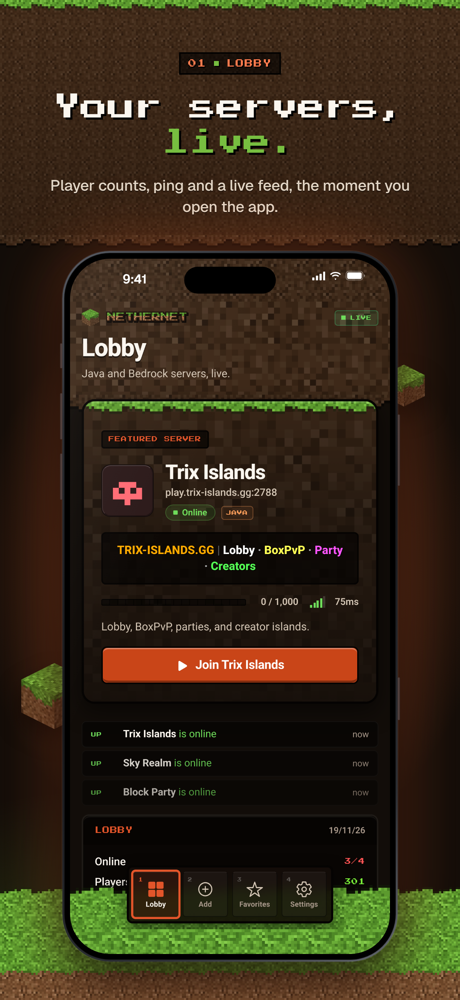
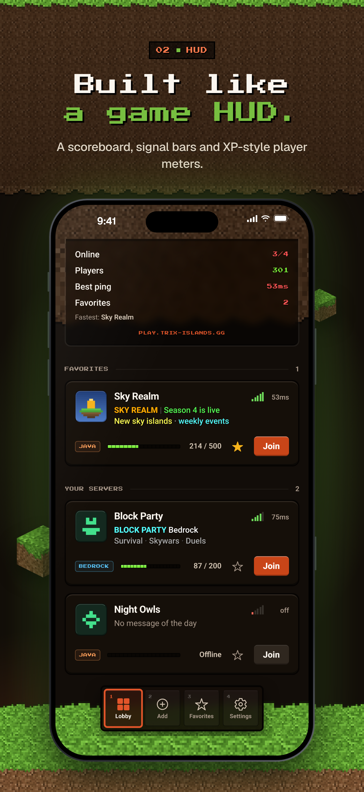
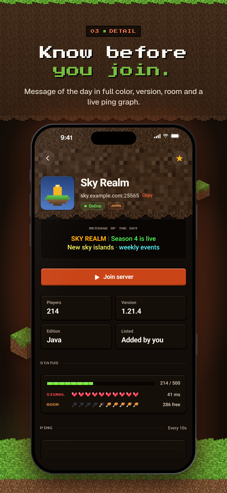
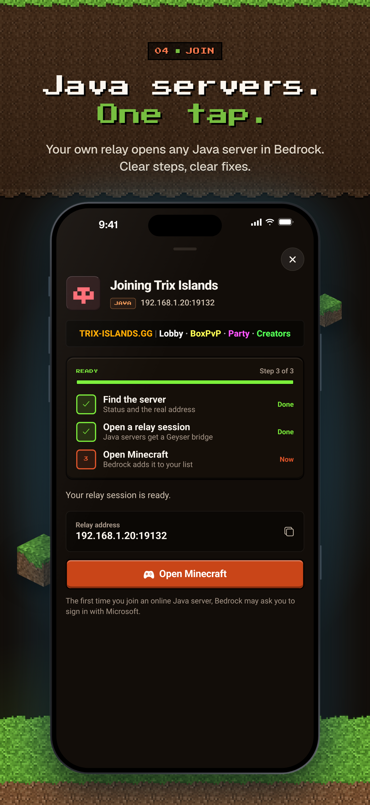
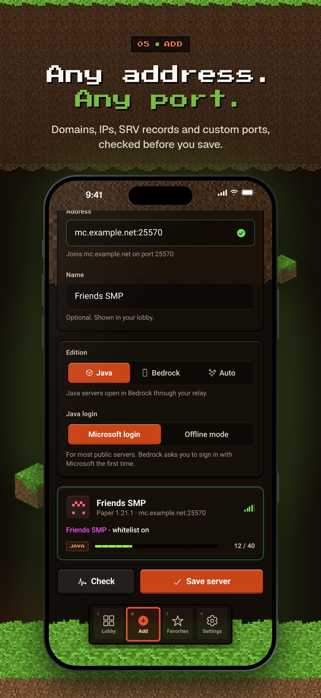

# NetherNet

NetherNet is an iOS app for joining Minecraft servers from an iPhone or iPad. It is a server browser and launcher. The game itself stays Minecraft Bedrock, so you keep the normal touch controls.

Java Edition servers are reached through a small relay you host. The relay starts [Geyser](https://geysermc.org/) standalone for the server you picked and speaks Bedrock on the outside. Bedrock servers skip the relay and open directly, including custom ports.

NetherNet does not ship a Minecraft client and does not include Mojang's assets.

## Screenshots

App Store images live in `docs/screenshots/iphone-6.9/` (1320×2868) and `docs/screenshots/ipad-13/` (2064×2752):







Store copy is in [store/metadata.md](store/metadata.md). The public site, privacy policy, and support page are in `docs/` and publish to [commander17x.github.io/NetherNet](https://commander17x.github.io/NetherNet/).

## What you can do in the app

- A lobby with a scoreboard (servers online, players, best ping), a live feed of servers coming up, going down or filling up, and Trix Islands (`play.trix-islands.gg`) pinned as the featured server.
- Add any server as a hostname, `host:port`, or `[IPv6]:port`.
- Pick Java, Bedrock, or Auto. Auto asks the status APIs and keeps whichever edition answers.
- Plain domains follow Minecraft SRV records (`_minecraft._tcp` for Java, `_minecraft._udp` for Bedrock). An explicit port always wins.
- See MOTD (legacy colors and JSON chat), player count, version and favicon. Server detail adds signal and room rows and a ping graph that updates every 10 seconds while open.
- Check a server before you save it. The add form shows a live preview or tells you it got no answer.
- Status comes from `api.mcsrvstat.us` and falls back to `api.mcstatus.io`, with a short cache and pull-to-refresh.
- Favorite servers. The list is stored on the device.
- Join in one tap through a three-step sheet that says what failed and how to fix it. Bedrock opens `minecraft://?addExternalServer=...`. Java asks your relay for a session first, then opens the same kind of link pointed at the relay.

## Run the app

You need Node 22. A Mac is only required if you are building a signed iOS binary yourself. Expo Go on a phone is enough for day-to-day work.

```bash
npm install
npx expo start
```

Scan the QR code with the camera (iOS) and open the project in Expo Go. The simulator command is `npm run ios`, which needs Xcode.

Set the relay under Settings. Use a host the phone can actually reach. `http://127.0.0.1:8787` points at the phone, not your computer. On a home network that is usually something like `http://192.168.1.20:8787`.

`EXPO_PUBLIC_RELAY_URL` is the default relay address for a fresh install:

```bash
EXPO_PUBLIC_RELAY_URL=http://192.168.1.20:8787 npx expo start
```

### A build you can install

Expo Go is fine for the list and for opening Minecraft. A dev or store build is what you want once you care about `LSApplicationQueriesSchemes` and your own icon. The iOS bundle id in `app.json` is `com.cuboagency.nethernet`. Change it if you ship under a different Apple developer account.

```bash
npx eas-cli login
npx eas-cli build -p ios --profile preview
```

`eas.json` has `development`, `preview`, and `production` profiles. Signing is done by your Apple account through EAS. This repo does not include certificates.

The app allows plain HTTP so a relay on your LAN works. Prefer HTTPS once the relay is on the public internet.

## Run the relay

The relay is a Node service in `relay/`. Docker Compose builds it with Java 21 and the current Geyser standalone jar. Each Java join gets its own Geyser process and a Bedrock port from `19132` upward.

Full hosting notes, firewall ports, auth, and the public server list are in [relay/README.md](relay/README.md).

```bash
cd relay
export PUBLIC_HOST=192.168.1.20
docker compose up --build
```

`PUBLIC_HOST` is the address written into the Minecraft link. Then in the app, set the relay to `http://192.168.1.20:8787`.

Check it:

```bash
curl -s http://127.0.0.1:8787/health
curl -s http://127.0.0.1:8787/servers
```

## Tests

```bash
npm test
npm run typecheck
npm run lint
cd relay && npm test && npm run typecheck
```

App tests cover address parsing, MOTD colors and JSON chat, and status decoding. Relay tests cover Geyser config rendering, session startup, and the HTTP API.

## Project layout

| Path | What it is |
| --- | --- |
| `src/app` | Expo Router screens |
| `src/components` | The server list, forms, and join flow |
| `src/lib` | Status lookup, storage, and the relay client |
| `shared` | Parsers used by both the app and the relay |
| `relay` | Geyser session service |
| `tools/textures.py` | Draws the grass, dirt and stone textures, the block icon, the wordmark and the app icon (needs Pillow) |

## License

[MIT](LICENSE). See [CONTRIBUTING.md](CONTRIBUTING.md) if you want to send a change.
